# Design Document

_Parte A — Transfer Learning_

## Overview

Este diseño describe **cómo** se completará el notebook `ParteA/notebook_parte_a/TransferLearningWorkshop.ipynb` para satisfacer los requisitos R1–R18 del `requirements.md` ya aprobado. El enfoque es de **cambios mínimos**: se conservan las celdas y funciones base del notebook (`check_image_dir`, `display_dataset`, `train_epoch`, `eval_epoch`, `train`, `plot_results`) y se interviene únicamente en:

1. **Los TODO existentes** (TODO 1 a TODO 6), que son los puntos marcados para completar.
2. **Celdas nuevas** necesarias por reglas derivadas de los steering: configuración de rutas (`DATA_ROOT`/`CKPT_DIR`, semilla), descarga del dataset desde Kaggle vía CLI con Secrets de Colab, `Celda_Verificacion` de estructura de carpetas, medición de tiempos por época, experimentos adicionales (data augmentation y scheduler), sección opcional EfficientNet-B0, celda de respuestas de investigación (las 8 preguntas del `.md`) y un `Smoke_Test` local.
3. **Correcciones demostrables documentadas**: la fuente del dataset (Kaggle en lugar del ZIP de Microsoft, D1) y el `summary(..., input_size=(1, 3, 224, 224))` (D3).

El código se **escribe en local** (sin GPU ni datos) y se **ejecuta en Colab**. Por eso el diseño separa de forma explícita lo verificable en local (shapes con `weights=None`, conteo de parámetros entrenables, validación `nbformat`) de lo que solo puede confirmarse en Colab (estructura real del dataset, accuracies, tiempos, curvas), que se materializa mediante `Celda_Verificacion` (SUPUESTO comprobado por código) y plantillas con el `Marcador_Pendiente` `<!-- COMPLETAR tras ejecución -->`.

### Decisiones de diseño y su justificación

| Decisión | Justificación | Requisitos |
|---|---|---|
| Variables `DATA_ROOT` y `CKPT_DIR` con rutas relativas | Un mismo notebook corre igual en local y Colab sin literales absolutos | R1.2, R1.4 |
| Fuente de datos Kaggle `kunalgupta2616/dog-vs-cat-images-data` vía CLI | El `.md` (Actividad 1) manda sobre el notebook base (D1) | R2.1, R2.2 |
| `Celda_Verificacion` que inspecciona la estructura real por código | No inventar nombres de carpetas; fijar la raíz de `ImageFolder` sin asumir literales | R2.4, R2.5, R2.7, R13.3 |
| Determinar `in_features`/conteos por código, no por texto | Regla anti-invención: no afirmar métricas/conteos no verificados | R7.3, R9.3, R13.4 |
| Smoke test con `weights=None` + tensores aleatorios | Única verificación posible en local sin GPU ni datos | R15.1–R15.3 |
| Plantillas con `Marcador_Pendiente` para toda respuesta empírica | No inventar accuracy, tiempos ni comparación de curvas | R10.2, R10.3, R10.7, R10.8, R13.1, R13.2 |
| Un tag distinto por experimento bajo `runs/` + curvas `plot_results` | Comparación en TensorBoard y reporte autocontenido | R17.2, R17.3 |

## Architecture

### Flujo del notebook (secciones)

El notebook mantiene su estructura por secciones. El diseño añade celdas donde lo exigen los requisitos derivados, sin alterar el orden lógico base.

```mermaid
flowchart TD
    S0["Sec. 0 — Imports y configuración\ndevice, DATA_ROOT, CKPT_DIR, seed 42"] --> S1["Sec. 1 — Funciones auxiliares\n(base, sin cambios)"]
    S1 --> S2["Sec. 2 — Dataset Cats vs Dogs\nMarkdown D1 + descarga Kaggle (CLI/Secrets)\n+ Celda_Verificacion estructura\n+ check_image_dir + ImageFolder + TODO 1 transforms"]
    S2 --> S3["Sec. 3 — VGG-16 preentrenado\ninferencia [1,1000] + clase ImageNet + summary 224 (D3)"]
    S3 --> S4["Sec. 4 — Extracción de features\nTODO 2: feature_tensor [800, 512*7*7]"]
    S4 --> S5["Sec. 5 — Clasificador lineal (M1)\nTODO 3: Linear(512*7*7, 2), 5 épocas"]
    S5 --> S6["Sec. 6 — Reemplazar classifier (M2 congelado)\nTODO 4: Linear(25088,2) + congelar features\n+ conteo entrenables por código + 1 época + .pth"]
    S6 --> S7["Sec. 7 — Fine-tuning (M2 fine-tuned)\nTODO 5: descongelar features + 1 época lr=1e-4\n+ experimento scheduler (preg. 3/7)"]
    S7 --> S8["Sec. 8 — ResNet-18 (M3)\nTODO 6: congelar + fc.in_features por código\n+ Linear→2 + 2 épocas + tiempos por época"]
    S8 --> SAUG["Experimento data augmentation (preg. 2)"]
    SAUG --> S9["Sec. 9 — TensorBoard\n%load_ext + %tensorboard --logdir runs"]
    S9 --> SEFF["Sección opcional — EfficientNet-B0 (preg. 8)"]
    SEFF --> S10["Sec. 10 — Preguntas de investigación 1–8"]
    S10 --> SMOKE["Smoke_Test local (weights=None): M2 y M3"]
```



### Entorno dual local/Colab

- **Local (escritura):** solo se valida que el `.ipynb` esté bien formado (`nbformat`) y, conceptualmente, que el `Smoke_Test` construya M2/M3 con `weights=None` verificando shapes y conteo de parámetros entrenables. No se descargan datos ni pesos.
- **Colab (ejecución):** se obtienen credenciales de Kaggle desde Secrets, se descarga el dataset, se ejecutan los entrenamientos con GPU, se completan las plantillas empíricas y se confirman los SUPUESTOS de las `Celda_Verificacion`.

### Configuración (Sec. 0) — R1

Se añade a la celda de configuración (sin eliminar `device`):

- `device = 'cuda' if torch.cuda.is_available() else 'cpu'` (ya presente) — R1.1.
- `DATA_ROOT` y `CKPT_DIR` como rutas relativas configurables, p. ej. `DATA_ROOT = 'data'` y `CKPT_DIR = 'data'`, definidas antes de su primer uso — R1.2, R1.4.
- `os.makedirs(DATA_ROOT, exist_ok=True)` y `os.makedirs(CKPT_DIR, exist_ok=True)`.
- `torch.manual_seed(42)` y uso de `torch.Generator().manual_seed(42)` en los `random_split` — R1.3.
- Todas las rutas de datos/checkpoint posteriores se construyen con `os.path.join(DATA_ROOT, ...)` / `os.path.join(CKPT_DIR, ...)` en lugar de literales (p. ej. `'data/cats_dogs_weights.pth'` → `os.path.join(CKPT_DIR, 'cats_dogs_weights.pth')`) — R1.4.

> Nota de cambios mínimos (R1.5): las funciones auxiliares de la Sec. 1 no se modifican.

## Components and Interfaces

Esta sección describe las piezas clave y sus firmas. Los valores marcados como "determinado por código al ejecutar" o SUPUESTO **no** se fijan en texto, en cumplimiento de las reglas anti-invención (R13.4).

### Pipeline de datos

**Descarga Kaggle (Sec. 2, reemplaza la celda `wget`) — R2.1–R2.3**

- Celda Markdown que documenta la discrepancia **D1**: el `.md` exige el dataset de Kaggle `kunalgupta2616/dog-vs-cat-images-data`; el notebook base usaba el ZIP de Microsoft con `wget`. Prevalece el `.md`.
- Celda de código que usa la **CLI de Kaggle** para descargar el dataset. Patrón de diseño (los nombres de archivo/carpeta reales se confirman en la `Celda_Verificacion`):
  - En Colab, obtener credenciales desde Secrets, sin incrustarlas en el código. Patrón:
    ```python
    # En Colab: credenciales desde Secrets (no se incrustan en el código)
    from google.colab import userdata
    os.environ['KAGGLE_USERNAME'] = userdata.get('KAGGLE_USERNAME')
    os.environ['KAGGLE_KEY'] = userdata.get('KAGGLE_KEY')
    # Descarga vía CLI de Kaggle hacia DATA_ROOT
    !kaggle datasets download -d kunalgupta2616/dog-vs-cat-images-data -p "$DATA_ROOT" --unzip
    ```
  - El nombre exacto del ZIP y la carpeta extraída son **SUPUESTO** hasta ejecutar; la raíz final de `ImageFolder` la fija la `Celda_Verificacion` (R2.7).

**Celda_Verificacion de estructura (Sec. 2, nueva) — R2.4, R2.5, R2.7, R13.3**

- Inspecciona por código el árbol de carpetas descomprimido bajo `DATA_ROOT` (p. ej. recorriendo con `os.walk`) e **imprime el árbol**.
- Determina por código la **raíz adecuada para `ImageFolder`**: la carpeta cuyos subdirectorios directos son las clases (dos subcarpetas con imágenes). Interfaz lógica:
  ```python
  def encontrar_raiz_imagefolder(base):
      """Devuelve la carpeta cuyos hijos directos son subdirectorios de clases
      con imágenes. SUPUESTO a confirmar en Colab si no es determinable."""
      ...
  IMAGEFOLDER_ROOT = encontrar_raiz_imagefolder(DATA_ROOT)
  ```
- IF la estructura no puede determinarse por código, THEN imprime el árbol inspeccionado y marca `IMAGEFOLDER_ROOT` como **SUPUESTO** a confirmar en Colab (R2.7).

**Limpieza de corruptas (Sec. 2) — R2.6**

- Se conserva la invocación de `check_image_dir`, pero los patrones glob se derivan de `IMAGEFOLDER_ROOT` y de los nombres de clase reales descubiertos por la verificación, en vez de los literales `data/PetImages/Cat` y `data/PetImages/Dog`. Patrón:
  ```python
  for clase in os.listdir(IMAGEFOLDER_ROOT):
      check_image_dir(os.path.join(IMAGEFOLDER_ROOT, clase, '*'))
  ```

**Construcción de `ImageFolder` y split (Sec. 2) — R2.5, R1.3**

- `dataset = torchvision.datasets.ImageFolder(IMAGEFOLDER_ROOT, transform=trans)` usando la raíz verificada, sin literales de nombres de clase.
- El `random_split` base `[20000, len(dataset) - 20000]` depende del tamaño real del dataset de Kaggle, que es un **SUPUESTO**. Ver "Error Handling" para el ajuste defensivo del split cuando el dataset tenga menos de 20000 imágenes.

**Pipeline_Transforms (TODO 1, Sec. 2) — R3**

- `trans = transforms.Compose([Resize(256), CenterCrop(224), ToTensor(), std_normalize])` en ese orden exacto (R3.1).
- `std_normalize` ya usa `mean=[0.485, 0.456, 0.406]`, `std=[0.229, 0.224, 0.225]` (R3.2); se conserva.
- Celda Markdown en español con la respuesta a la Pregunta_Teorica de la Actividad 1 (origen de media/std de ImageNet y por qué importan con pesos preentrenados) — R3.3.

### Modelos

**M1 — VGG-16 features fijas + clasificador lineal (Sec. 3–5)**

- Carga con API moderna: `vgg = torchvision.models.vgg16(weights=torchvision.models.VGG16_Weights.DEFAULT)` (ya presente, sin `pretrained=True`) — R4.1.
- Inferencia de muestra: verificar por código `res.shape == torch.Size([1, 1000])` y mostrar la clase ImageNet vía `class_map` (celdas base conservadas) — R4.2, R4.3.
- `summary(vgg, input_size=(1, 3, 224, 224))` ya usa 224 (D3): se deja constancia y se asegura que **todas** las llamadas a `summary` usen 224 — R7.4, D3.
- Celdas Markdown en español: nº total de parámetros de VGG-16 (obtenido por código/`summary`, no afirmado en texto), qué hace Dropout, por qué 1000 salidas — R4.4, R10.9.
- **Extracción de features (TODO 2, Sec. 4) — R5:**
  ```python
  feature_tensor = torch.zeros(num, 512*7*7)   # [800, 25088]
  label_tensor   = torch.zeros(num)            # [800]
  # dentro del loop, con torch.no_grad():
  #   f = vgg.features(x.to(device)).flatten(1).cpu()  # [bs, 512*7*7]
  #   feature_tensor[i:i+bs] = f ; label_tensor[i:i+bs] = l
  ```
  Se imprimen los shapes finales para verificación — R5.4.
- **Clasificador lineal (TODO 3, Sec. 5, M1) — R6:**
  - `net = nn.Linear(512*7*7, 2)` (una sola capa lineal, **sin** `LogSoftmax`) — R6.1.
  - Entrenamiento 5 épocas con `nn.CrossEntropyLoss` (default de `train`) y logging en TensorBoard tag `linear` — R6.2.
  - Celda Markdown en español: diferencia `CrossEntropyLoss` vs `NLLLoss + LogSoftmax` y por qué combinarlos es un error — R6.3.

**M2 — VGG-16 classifier reemplazado + fine-tuning por etapas**

- **Etapa congelada (TODO 4, Sec. 6) — R7:**
  - `vgg = torchvision.models.vgg16(weights=torchvision.models.VGG16_Weights.DEFAULT)` limpio — R7.1.
  - `vgg.classifier = nn.Linear(25088, 2)` — R7.1.
  - Congelar `features`: `for p in vgg.features.parameters(): p.requires_grad = False` — R7.2.
  - Conteo de entrenables **por código** (no por texto): `sum(p.numel() for p in vgg.parameters() if p.requires_grad)` e imprimirlo — R7.3. El valor "~50k" del `.md` se trata como SUPUESTO confirmable al ejecutar.
  - `summary(vgg, input_size=(1, 3, 224, 224))` (D3) — R7.4.
  - Entrenar 1 época sobre el dataset completo, tag `frozen` en TensorBoard — R7.5.
  - Guardar en `os.path.join(CKPT_DIR, 'cats_dogs_weights.pth')` — R7.6.
  - Celda Markdown en español: por qué congelar las convolucionales antes de entrenar la cabeza — R7.7, R10.9.
- **Etapa fine-tuned (TODO 5, Sec. 7) — R8:**
  - Recargar la arquitectura (`vgg16(weights=None)` + `classifier = nn.Linear(25088, 2)`) y `load_state_dict` desde `os.path.join(CKPT_DIR, 'cats_dogs_weights.pth')` — R8.1.
  - Descongelar: `for p in vgg.features.parameters(): p.requires_grad = True` — R8.2.
  - Entrenar 1 época con `lr=1e-4`, tag `finetuned` — R8.3.
  - Comparación de curvas congelado vs fine-tuned con tags separados bajo `runs/` — R8.4.

**M3 — ResNet-18 adaptado (TODO 6, Sec. 8) — R9**

- `resnet18 = models.resnet18(weights=models.ResNet18_Weights.DEFAULT)` (API moderna) — R9.1.
- Congelar todos los parámetros: `for p in resnet18.parameters(): p.requires_grad = False` — R9.2.
- Determinar entradas **por código** y reemplazar `fc`:
  ```python
  num_features = resnet18.fc.in_features   # determinado por código, no afirmado en texto
  resnet18.fc = nn.Linear(num_features, 2)
  ```
  — R9.3.
- Entrenar 2 épocas, tag `resnet18` — R9.4.
- **Medición de tiempos por época [DERIVADO]:** envolver cada época con `time.time()` para VGG y ResNet e imprimir los tiempos para comparación — R9.5. Se implementa como una celda que mide alrededor de las llamadas a entrenamiento (sin alterar la firma de `train`), p. ej. midiendo el tiempo total y dividiendo por épocas, o entrenando época a época dentro de un bloque cronometrado.
- Celda Markdown en español: qué es un residual block y qué problema resuelve — R9.6, R10.9.
- La parte empírica ("¿ResNet-18 entrena más rápido que VGG y por qué?") se deja como **plantilla con `Marcador_Pendiente`** más el código que imprime los tiempos — R9.7.

### Experimentos adicionales de investigación

**Data augmentation (pregunta 2) — R10.2, R11.1, R11.3**

- Nueva celda que define un pipeline de entrenamiento con augmentations (p. ej. `RandomHorizontalFlip`, `RandomRotation`, `ColorJitter`) manteniendo `Resize(256)→CenterCrop(224)→ToTensor→Normalize` para la rama de validación.
- Entrena con esos transforms registrando curvas en TensorBoard con un **tag distinto** bajo `runs/` (p. ej. `runs/aug`).
- Conclusión empírica (impacto en generalización) como **plantilla con `Marcador_Pendiente`** + el código que produce las curvas — R11.3.

**Scheduler StepLR/CosineAnnealingLR (preguntas 3 y 7) — R10.3, R10.7, R11.2, R11.3**

- Nueva celda en el contexto del fine-tuning de la Actividad 5 que añade `torch.optim.lr_scheduler.StepLR` o `CosineAnnealingLR` al loop, con `optimizer.step()` seguido de `scheduler.step()` por época.
- Como la firma de `train` no expone scheduler, el experimento se implementa en una celda dedicada con un loop explícito que reutiliza `train_epoch`/`eval_epoch` y añade el `scheduler`, registrando en TensorBoard con un **tag distinto** (p. ej. `runs/finetuned_sched`).
- La respuesta sustantiva sobre schedulers se da **una sola vez** en la pregunta 3; la pregunta 7 la **referencia explícitamente** sin duplicar contenido — R10.7.
- Conclusión empírica como **plantilla con `Marcador_Pendiente`** + código de curvas — R11.3.

### Sección opcional EfficientNet-B0 (pregunta 8) — R10.8, R12

- Sección rotulada **opcional** que carga `torchvision.models.efficientnet_b0(weights=EfficientNet_B0_Weights.DEFAULT)` (API moderna), congela el backbone y adapta el clasificador final determinando sus entradas **por código** (p. ej. `model.classifier[-1].in_features`).
- Comparación de accuracy final y tiempo de entrenamiento contra ResNet-18 y VGG-16 como **plantilla con `Marcador_Pendiente`** + el código que mide esos valores — R12.2.

### Logging y comparación (Sec. 9) — R17

- Cada experimento escribe en un `SummaryWriter` con **tag distinto** bajo `runs/` (`linear`, `frozen`, `finetuned`, `resnet18`, `aug`, `finetuned_sched`, y opcional EfficientNet), de modo que las curvas sean comparables en TensorBoard — R17.2.
- Celda de TensorBoard con `%load_ext tensorboard` y `%tensorboard --logdir runs` (base, conservada) — R17.1.
- Cada experimento también dibuja sus curvas con `matplotlib` vía `plot_results(history)` dentro del notebook, para que el reporte sea autocontenido aunque el panel de TensorBoard no se conserve — R17.3.

### Respuestas de investigación 1–8 (Sec. 10) — R10

Se reescribe la Sec. 10 para cubrir las **8** preguntas del `.md` en su numeración (D2). Clasificación por tipo:

| Pregunta `.md` | Tipo | Tratamiento | Requisito |
|---|---|---|---|
| 1 — cuándo NO transfer learning | Teórica | Markdown en español, ≥2 escenarios concretos | R10.1 |
| 2 — data augmentation | Empírica | Experimento + plantilla `Marcador_Pendiente` | R10.2, R11.1, R11.3 |
| 3 — StepLR/CosineAnnealingLR en Act. 5 | Empírica | Experimento + plantilla (respuesta única) | R10.3, R11.2, R11.3 |
| 4 — BatchNorm en ResNet vs VGG | Teórica | Markdown en español | R10.4 |
| 5 — origen media/std ImageNet | Teórica | Markdown en español | R10.5 |
| 6 — CrossEntropy vs NLLLoss vs LogSoftmax | Teórica | Markdown en español | R10.6 |
| 7 — learning rate scheduling | Empírica | Referencia explícita a la pregunta 3 | R10.7 |
| 8 — EfficientNet-B0 (opcional) | Empírica | Sección opcional + plantilla | R10.8, R12 |

Las partes teóricas de las preguntas de actividad (Dropout, 1000 salidas, congelar convolucionales, residual block) se responden en sus secciones y/o en la Sec. 10 — R10.9. El nivel de confianza de cada respuesta teórica y qué comprobar se registran en `notas_verificacion.md`, **fuera** del notebook — R10.10.

## Data Models

No hay persistencia estructurada ni esquemas de base de datos. Los "modelos de datos" relevantes son los tensores y artefactos que fluyen por el notebook:

| Artefacto | Forma / tipo | Origen | Requisito |
|---|---|---|---|
| `DATA_ROOT`, `CKPT_DIR` | `str` (ruta relativa) | Sec. 0 | R1.2, R1.4 |
| `IMAGEFOLDER_ROOT` | `str` determinado por código (SUPUESTO si no determinable) | `Celda_Verificacion` | R2.4, R2.5, R2.7 |
| `dataset` | `ImageFolder` sobre `IMAGEFOLDER_ROOT`; `dataset.classes` descubierto por código | Sec. 2 | R2.5 |
| `trans` | `transforms.Compose` (Resize256→CenterCrop224→ToTensor→Normalize) | TODO 1 | R3.1, R3.2 |
| `feature_tensor` | `torch.Tensor` shape `[800, 512*7*7]` | TODO 2 | R5.1, R5.3 |
| `label_tensor` | `torch.Tensor` shape `[800]` | TODO 2 | R5.1 |
| `net` (M1) | `nn.Linear(512*7*7, 2)` | TODO 3 | R6.1 |
| `vgg.classifier` (M2) | `nn.Linear(25088, 2)` | TODO 4 | R7.1 |
| checkpoint `.pth` | `state_dict` en `os.path.join(CKPT_DIR, 'cats_dogs_weights.pth')` | Sec. 6/7 | R7.6, R8.1 |
| `resnet18.fc` (M3) | `nn.Linear(resnet18.fc.in_features, 2)` (in_features por código) | TODO 6 | R9.3 |
| `history` | `dict` con `train/val loss/acc` por época | `train` (base) | R17.3 |
| logs TensorBoard | subdirectorios por experimento bajo `runs/` | `SummaryWriter` | R17.2 |

Valores explícitamente **no fijados** en el diseño (reglas anti-invención, R13.4): nombres reales de carpetas/clases del dataset de Kaggle, número total de imágenes, accuracies, tiempos por época, conteo exacto de parámetros entrenables (~50k) y número total de parámetros de VGG-16. Todos se "determinan por código al ejecutar" o se dejan como SUPUESTO/plantilla.

## Error Handling

El manejo de errores se materializa como celdas de verificación y caminos defensivos pensados para Colab, sin inventar valores:

1. **Credenciales de Kaggle ausentes.** La celda de descarga asume credenciales en Secrets de Colab. Diseño: envolver la obtención de credenciales de forma que, si faltan, se imprima un mensaje claro indicando cómo configurarlas en Secrets (`KAGGLE_USERNAME`, `KAGGLE_KEY`) y que la descarga no puede continuar sin ellas. No se incrustan credenciales en el código (R2.3). Este punto solo se confirma en Colab.

2. **Estructura de carpetas no determinable (R2.7).** Si `encontrar_raiz_imagefolder` no identifica una única raíz con subdirectorios de clase, la `Celda_Verificacion`:
   - Imprime el **árbol de directorios** inspeccionado (`os.walk`).
   - Marca `IMAGEFOLDER_ROOT` como **SUPUESTO** con un comentario `# SUPUESTO: confirmar en Colab` para ajuste manual.

3. **Tamaño del dataset distinto al split base 20000/resto (R2.5, SUPUESTO).** El `random_split([20000, len(dataset) - 20000])` del notebook base falla si el dataset tiene ≤ 20000 imágenes. Diseño defensivo: calcular el tamaño de train por proporción cuando el dataset sea menor, p. ej.
   ```python
   n = len(dataset)
   n_train = 20000 if n > 20000 else int(0.8 * n)
   trainset, testset = torch.utils.data.random_split(
       dataset, [n_train, n - n_train],
       generator=torch.Generator().manual_seed(42))
   ```
   Esto mantiene la reproducibilidad (semilla 42) y evita un split inválido. El valor real de `n` es SUPUESTO hasta ejecutar.

4. **Imágenes corruptas.** Se conserva `check_image_dir` (R2.6) aplicado sobre las clases reales descubiertas, de modo que `ImageFolder` no falle al abrir archivos dañados.

5. **Carga de checkpoint (R8.1).** La recarga en la etapa fine-tuned reconstruye primero la arquitectura (`vgg16(weights=None)` + `classifier = nn.Linear(25088, 2)`) antes de `load_state_dict`, para que las claves coincidan; se usa `weights_only=True` como en el notebook base.

## Testing Strategy

### Por qué NO se usa Property-Based Testing

Esta feature consiste en **completar un notebook** cuyo valor se materializa al ejecutarse en Colab: descarga de dataset, carga de modelos preentrenados, entrenamientos con efectos secundarios (checkpoints, logs de TensorBoard) y visualizaciones. No hay funciones puras propias con propiedades universales "para todo input X se cumple P(X)" que podamos afirmar y validar en local; además, el entorno de escritura carece de GPU, datos y pesos. Según la guía del flujo, estos casos (notebook/UI/rendering, operaciones con efectos secundarios, dependencias externas e infraestructura de descarga) **no son apropiados para PBT**. Por tanto, **se omite la sección Correctness Properties** y la verificación se define a nivel de notebook.

### Verificación local permitida (sin datos ni GPU) — R15

1. **Smoke_Test (celda nueva, al final del notebook) con `weights=None` y tensores aleatorios — R15.1–R15.3.** No descarga pesos ni datos. Verifica por código:
   - **M2:** VGG-16 con `vgg.classifier = nn.Linear(25088, 2)` y `features` congeladas → `out.shape == (B, 2)` para una entrada aleatoria `[B, 3, 224, 224]`, y conteo de parámetros entrenables `sum(p.numel() for p in vgg.parameters() if p.requires_grad)` (impreso, no afirmado en texto).
   - **M3:** ResNet-18 con `fc` reemplazado determinando `in_features` por código y backbone congelado → `out.shape == (B, 2)` y conteo de entrenables impreso.
   - Patrón:
     ```python
     x = torch.randn(2, 3, 224, 224)   # tensores aleatorios, sin datos reales
     # M2 con weights=None
     m2 = torchvision.models.vgg16(weights=None)
     m2.classifier = nn.Linear(25088, 2)
     for p in m2.features.parameters(): p.requires_grad = False
     assert m2(x).shape == (2, 2)
     # M3 con weights=None
     m3 = torchvision.models.resnet18(weights=None)
     m3.fc = nn.Linear(m3.fc.in_features, 2)
     for p in m3.parameters(): p.requires_grad = False
     for p in m3.fc.parameters(): p.requires_grad = True
     assert m3(x).shape == (2, 2)
     ```
2. **Validación `nbformat` — R15.4.** El entregable debe ser un `.ipynb` bien formado; se valida con `nbformat` (fuera del notebook, en el entorno de escritura).

### Qué se verifica en Colab (fuera del alcance local)

- Confirmación de los SUPUESTOS de las `Celda_Verificacion` (estructura real del dataset, raíz de `ImageFolder`, nombres de clase).
- Valores empíricos: accuracies de M1/M2/M3 y opcional, tiempos por época (R9.5/R9.7), conteo definitivo de entrenables (~50k), nº total de parámetros de VGG-16, clase ImageNet predicha, y comparación de curvas (congelado vs fine-tuned, con/sin augmentation, con/sin scheduler).
- Todas estas respuestas quedan como **plantilla con `Marcador_Pendiente`** acompañadas del código que imprime los números/curvas (R13.1, R13.2), y como SUPUESTO + `Celda_Verificacion` cuando aplica (R13.3).

### Reglas anti-invención materializadas en el diseño — R13

- **`Celda_Verificacion`** (SUPUESTO comprobado por código): estructura del dataset (R2.4/R2.7), shapes de inferencia (R4.2), shapes de `feature_tensor`/`label_tensor` (R5.4), conteos de entrenables (R7.3/R9.3), y el `Smoke_Test` (R15).
- **`Marcador_Pendiente`** `<!-- COMPLETAR tras ejecución -->`: toda respuesta empírica (preguntas 2, 3, 7, 8; "¿ResNet más rápido?" R9.7; accuracies; tiempos; comparación de curvas), siempre con el código que produce lo necesario para completarla.
- **`notas_verificacion.md`** (fuera del notebook): nivel de confianza (alto/medio/bajo) por respuesta teórica y qué comprobar (R10.10).

### Autocontención y español — R14

- Cada bloque de código relevante va precedido de una celda Markdown explicativa en español (R14.1).
- Todos los títulos, explicaciones y respuestas en español (R14.2).

### Entregable — R16, R18

- El entregable final se renombra a `grupoSamuelHerrera_CristianCabarcas_EmmanuelAlvarez_LAB#2A.ipynb` (R16.1), autocontenido con todo el código y las respuestas en Markdown (R16.2).
- La ejecución "Run all" con todas las salidas visibles la realiza el **usuario en Colab** (Kiro no ejecuta el notebook); figura como ítem en la lista de verificación de entrega (R18).

## Trazabilidad diseño → requisitos

| Componente / decisión de diseño | Requisitos cubiertos |
|---|---|
| Configuración Sec. 0 (device, `DATA_ROOT`/`CKPT_DIR`, seed, rutas construidas, cambios mínimos) | R1.1–R1.5 |
| Markdown D1 + descarga Kaggle CLI + Secrets + `Celda_Verificacion` estructura + `check_image_dir` + `ImageFolder` por raíz verificada | R2.1–R2.7 |
| TODO 1 Pipeline_Transforms + Markdown media/std | R3.1–R3.3 |
| Carga VGG moderna, inferencia [1,1000], clase ImageNet, Markdown params/Dropout/1000 | R4.1–R4.4 |
| TODO 2 extracción features [800, 512*7*7] con `no_grad` + shapes | R5.1–R5.4 |
| TODO 3 `net`=Linear sin LogSoftmax, 5 épocas, Markdown CE vs NLL+LogSoftmax | R6.1–R6.3 |
| TODO 4 reemplazo classifier + congelar + conteo por código + `summary` 224 (D3) + 1 época + `.pth` + Markdown congelar | R7.1–R7.7 |
| TODO 5 cargar + descongelar + 1 época lr=1e-4 + comparación de curvas | R8.1–R8.4 |
| TODO 6 ResNet moderno + congelar + `fc.in_features` por código + 2 épocas + tiempos + Markdown residual + plantilla empírica | R9.1–R9.7 |
| Sec. 10 preguntas 1–8 (teóricas en Markdown, empíricas como plantilla, 7→ref a 3) + partes teóricas de actividad + `notas_verificacion.md` | R10.1–R10.10 |
| Experimentos data augmentation y scheduler con tags propios + plantillas | R11.1–R11.3 |
| Sección opcional EfficientNet-B0 + plantilla de comparación | R12.1–R12.2 |
| `Celda_Verificacion`, `Marcador_Pendiente`, evitar afirmar lo no verificado | R13.1–R13.4 |
| Markdown explicativo antes de cada bloque + todo en español | R14.1–R14.2 |
| Smoke_Test M2/M3 con `weights=None` + validación `nbformat` | R15.1–R15.4 |
| Entregable renombrado y autocontenido | R16.1–R16.2 |
| Tags distintos bajo `runs/` + celda TensorBoard + curvas `plot_results` | R17.1–R17.3 |
| Entregable ejecutado en Colab (Run all) + ítem en lista de verificación | R18.1–R18.3 |
